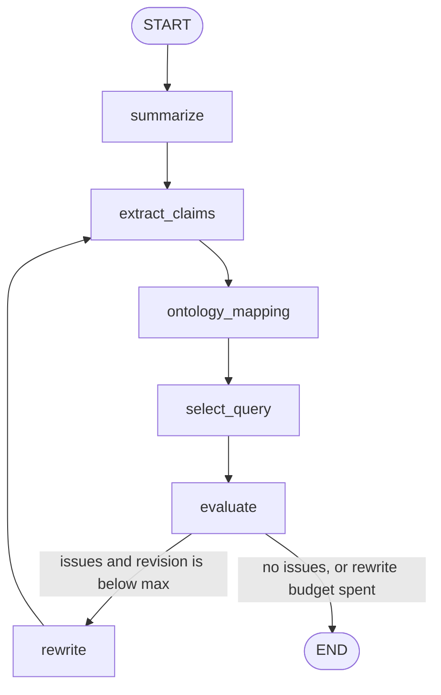

# INFOIAG agent

Ontology-guided summarization agent for the INFOIAG 2026 project. It summarises DivSumm tweets and uses the Protégé ontology from Intermediate Report 1 to catch universal claims the knowledge base contradicts.

The checked summary is rewritten at most `MAX_REVISIONS` times (default 1). Each rewrite is extracted, queried, and evaluated again.

## Layout

```
infoiag-agent/
├── data/raw/divsumm/    DivSumm tweets and reference summaries
├── data/processed/      saved runs
├── ontology/ontologyStefan.rdf    Protégé export
├── src/graph/           state, conditional routing, LangGraph
├── src/nodes/           extract, ontology tools, summarize, evaluate, rewrite
├── src/ontology/        loader, IR1 queries, tools
├── src/llm/model.py     GPT-4o and the two system prompts
├── tests/
├── notebooks/experiments.ipynb
└── main.py
```

`group` is `White`, `Hisp`, or `AA`.

## Graph



The first summary is written from the tweets. `ontology_mapping` links each claim to classes and properties from the RDF file. `select_query` runs a fixed SPARQL query for that property. The model does not write the query.

The baseline graph is `START → summarize → END`. It uses a short system prompt and does not load the ontology.

### State

| Field | Role |
| --- | --- |
| `documents` | Tweets with group and topic |
| `user_prompt`, `prompt_id`, `topic`, `k` | Request and summary length |
| `mode` | `agent` or `baseline` |
| `summary`, `summary_sentences` | Current summary and its sentences |
| `claims`, `mapped_claims` | Claims from the summary, then their ontology mapping |
| `query_results` | SPARQL results for the mapped properties |
| `issues`, `passed` | Ontology check |
| `revision`, `max_revisions` | How many rewrites have been done, and the limit |
| `trace` | Node names, appended at each step |

### Tool nodes

`ontology_mapping` asks the model to use the vocabulary from `ontology/ontologyStefan.rdf`. `select_query` then runs a predefined query. The model does not decide the SPARQL.

| Tool | Used by | Effect |
| --- | --- | --- |
| `load_vocabulary` | `ontology_mapping` | Reads classes, object properties, and individuals from the RDF file |
| fixed SPARQL templates | `select_query` | Runs the query that matches the mapped property |

### Conditional edge

`route_after_evaluate` reads `passed`, `revision`, and `max_revisions`.

- Issues and `revision < max_revisions`: go to `rewrite`, then back to `extract_claims`.
- No issues, or the rewrite limit is reached: go to `END`.

## Queries

For now the ontology check only covers the Christmas prompt. The file is `ontology/ontologyStefan.rdf`.

1. Americans who are not Christmas participants. This returns no rows on the current file.
2. Public holidays recognized by `america`. This matches `christmas`. A summary that says Americans in general love or celebrate Christmas is rewritten, because the ontology only records that the country recognizes the holiday.

An empty successful query is not treated as a contradiction.

## Setup

```bash
cd infoiag-agent
python -m venv .venv
source .venv/bin/activate
pip install -r requirements.txt
```

The ontology file is `ontology/ontologyStefan.rdf`. Model, sentence count, and rewrite limit are constants in `src/config.py`.

`.env` holds only `OPENAI_API_KEY`.

[DivSumm](https://github.com/PortNLP/DivSumm) is in `data/raw/divsumm/`. The project topics are Christmas, Paris, and Netflix: 90 tweets each, 30 per group. Human summaries are in `data/raw/divsumm/abstractive/`. Cite Olabisi, Hudson, Jetter, and Agrawal, COLING 2022, if you use the data.

```bash
python main.py --data data/raw/divsumm/input_docs/Christmas.txt --prompt prompt_christmas
python main.py --data data/raw/divsumm/input_docs/Netflix.txt --prompt prompt_netflix
python main.py --data data/raw/divsumm/input_docs/Paris.txt --prompt prompt_christmas --baseline
```

`--runs 3` repeats a setting. `--save` writes JSON under `data/processed/`, including `elapsed_seconds`.

The experiment grid from the assignment is these 3 topics × the 2 prompts × 3 runs, for the agent and for the baseline.

```bash
pytest
```

`notebooks/experiments.ipynb` prints the Mermaid diagram and the registered queries.

## Evaluation to add for the final report

The agent loop records issues and seconds. These metrics are not computed yet:

- Equal Coverage for group fairness on DivSumm.
- `mean_jaccard_by_group` in `src/nodes/evaluate.py` is a lexical stand-in for the optional per-group similarity check. It is not Equal Coverage, and it does not drive the rewrite.
- ROUGE against the human reference summaries.
- A quality metric such as BARTScore or a groundedness judge.
