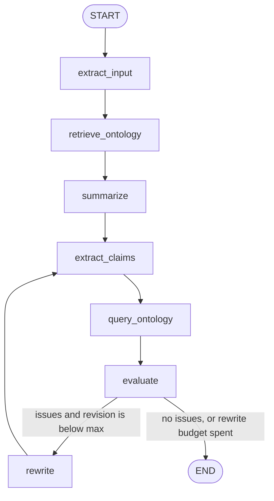

# INFOIAG agent

Ontology-guided summarization agent for the INFOIAG 2026 project. It summarises DivSumm tweets and uses the Protégé ontology from Intermediate Report 1 to catch universal claims the knowledge base contradicts.

The checked summary is rewritten at most `MAX_REVISIONS` times (default 1). Each rewrite is extracted, queried, and evaluated again.

## Layout

```
infoiag-agent/
├── data/raw/divsumm/    DivSumm tweets and reference summaries
├── data/processed/      saved runs
├── ontology/Ontology2809eva.rdf   Protégé export
├── src/graph/           state, conditional routing, LangGraph
├── src/nodes/           extract, ontology tools, summarize, evaluate, rewrite
├── src/ontology/        loader, IR1 queries, tools
├── src/llm/model.py     Ollama or OpenAI, plus the two system prompts
├── tests/
├── notebooks/experiments.ipynb
└── main.py
```

`group` is `White`, `Hisp`, or `AA`.

## Graph



The baseline graph is `START → summarize → END`. It uses a short system prompt and does not load the ontology.

### State

| Field | Role |
| --- | --- |
| `documents` | Tweets with group and topic |
| `user_prompt`, `prompt_id`, `topic`, `k` | Request and summary length |
| `mode` | `agent` or `baseline` |
| `extracted_input` | Group counts and the tweet text used for query selection |
| `ontology_context` | Query results passed into the first summary |
| `summary`, `summary_sentences` | Current summary and its sentences |
| `query_results` | Query results for this version of the summary |
| `issues`, `passed` | Ontology check |
| `revision`, `max_revisions` | How many rewrites have been done, and the limit |
| `trace` | Node names, appended at each step |

### Tool nodes

`retrieve_ontology` and `query_ontology` both call `run_queries_for_text`. The model does not decide whether the tools run.

| Tool | Used by | Effect |
| --- | --- | --- |
| `run_queries_for_text` | both ontology nodes | Selects the IR1 queries for the topic and text, then runs them |
| `list_classes` | notebook | Lists class names from the OWL file |

### Conditional edge

`route_after_evaluate` reads `passed`, `revision`, and `max_revisions`.

- Issues and `revision < max_revisions`: go to `rewrite`, then back to `extract_summary`.
- No issues, or the rewrite limit is reached: go to `END`.

## Queries

The Manchester queries from Intermediate Report 1 live in `src/ontology/queries.py`.

1. Americans who are not Christmas participants. Blocks "all Americans celebrate" when the query returns someone.
2. Positive Netflix reviews. Blocks "everyone dislikes Netflix" when a positive review is returned.
3. Metropolitan cities with a Netflix facility. Blocks a facility city that is not in a non-empty result.
4. Content offered by `netflixService`. This matches `theNotebookFilm` with genre `romanceGenre`. A summary that says everyone dislikes Netflix is rewritten because of this row.
5. Public holidays recognized by `america`. This matches `christmas`. A summary that says Americans in general love or celebrate Christmas is rewritten, because the ontology only records that the country recognizes the holiday.

SPARQL follows the property names in `Ontology2809eva.rdf` (`hasParticipant`, `hasFacilityIn`). The Manchester strings stay as written in Intermediate Report 1. Queries 1–3 return no rows until those individuals are added in Protégé. An empty successful query is not treated as a contradiction.

## Setup

```bash
cd infoiag-agent
python -m venv .venv
source .venv/bin/activate
pip install -r requirements.txt
```

The ontology file is `ontology/Ontology2809eva.rdf`. Its IRI is set in `.env`.

`.env` selects the model. `LLM_PROVIDER=ollama` talks to a local Ollama server. For OpenAI, set `OPENAI_API_KEY` and `LLM_PROVIDER=openai`.

[DivSumm](https://github.com/PortNLP/DivSumm) is in `data/raw/divsumm/`. The project topics are Christmas, Paris, and Netflix: 90 tweets each, 30 per group. Human summaries are in `data/raw/divsumm/abstractive/`. Cite Olabisi, Hudson, Jetter, and Agrawal, COLING 2022, if you use the data.

```bash
python main.py --data data/raw/divsumm/input_docs/Christmas.txt --prompt prompt_christmas
python main.py --data data/raw/divsumm/input_docs/Netflix.txt --prompt prompt_netflix
python main.py --data data/raw/divsumm/input_docs/Paris.txt --prompt prompt_christmas --baseline
```

`--runs 3` repeats a setting. `--save` writes JSON under `data/processed/`, including `elapsed_seconds`.

The experiment grid from the assignment is these 3 topics × the 2 prompts × 3 runs, for the agent and for the baseline.

```bash
pytest
```

`notebooks/experiments.ipynb` prints the Mermaid diagram and the registered queries.

## Evaluation to add for the final report

The agent loop records issues and seconds. These metrics are not computed yet:

- Equal Coverage for group fairness on DivSumm.
- `mean_jaccard_by_group` in `src/nodes/evaluate.py` is a lexical stand-in for the optional per-group similarity check. It is not Equal Coverage, and it does not drive the rewrite.
- ROUGE against the human reference summaries.
- A quality metric such as BARTScore or a groundedness judge.
