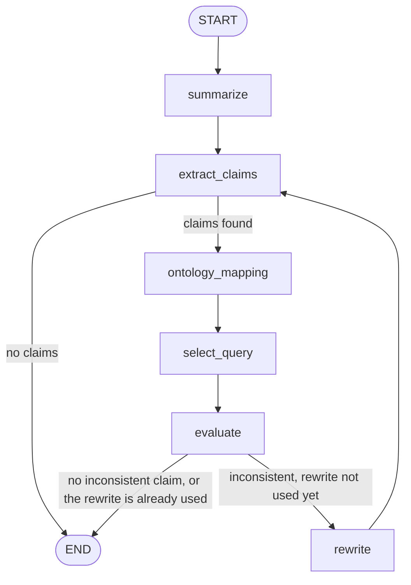

# Ontology-guided summarization agent

We are testing this on Christmas. The question we give the agent is:

> Summarise this text about Christmas in the United States. I want to know why Americans love to celebrate Christmas.

That question already assumes Americans love Christmas. The 90 tweets are what gets summarized. The ontology is only some background facts, not the tweets.

## Graph

The baseline is just `START → summarize → END`: one GPT-4o summary, no claims, no ontology.

The agent can rewrite once. After that, the new summary is checked again, and then it stops.

## What each step is supposed to do

### 1. summarize

Write five sentences from the tweets. The question is in the prompt, but the summary should follow the posts: gifts, trees, family, complaints. It should not answer by saying “Americans love Christmas.”

The model does not see the ontology here. We check the summary afterwards.

### 2. extract_claims

Turn the summary into small statements: who, what they do, and about what. We also store how broad it is. “Americans love Christmas” is broad. “Some posts mention gifts” is not.

This is a model call. It returns JSON. It does not look at the ontology.

### 3. ontology_mapping

Give the model the claim and a short list of what is actually in the ontology: classes, relations, and individuals. It tries to attach those names to the claim.

“America recognizes Christmas as a public holiday” can become `america`, `recognizesPublicHoliday`, `christmas`. “Americans love Christmas” has nothing to attach to “love,” because the ontology has no relation for that.

The model still does not write the query.

### 4. select_query

Python looks at the relation the mapper picked and runs one fixed query, or none.

| Mapped property | Query | What we get back |
| --- | --- | --- |
| `recognizesPublicHoliday` | Which country recognizes which public holiday? | `america` recognizes `christmas`. |
| `isParticipantOf` or `hasParticipant` | Is there an American in the file who does not take part in Christmas? | Nobody. The file has no such person. |
| anything else | No query | We do not check this claim on the ontology. |

### 5. evaluate

Each claim gets a label. Supported means the query found that fact. Contradicted means the ontology says something else. Not verifiable means there was no query, or the query came back empty.

A not-verifiable claim is kept in the log. It does not start a rewrite. “Americans love Christmas” is not verifiable, because the ontology has no relation for that.

### 6. rewrite, or stop

A rewrite happens only when a claim is contradicted, and only once. The new summary goes through claim extraction again, and then the run stops.

If nothing is contradicted, the run stops immediately.

## Where this gets stuck

Our ontology and queries do not contain enough information, and they are not formulated well enough, to actually detect the bias. The check can run, but it cannot catch the broad claim we care about.

The bias we want to catch is a summary that takes the question at face value. The question asks why Americans love Christmas, so a biased summary talks as if that is true of Americans in general. A fair summary stays with what the posts say, including complaints and mixed views, and does not turn the question into a fact.

To detect that, a query would have to say something about that kind of claim. The ontology does not really have material for it. The relations and individuals we have do not describe how people feel about Christmas, or who does and does not celebrate it. The queries we wrote are about other things, so they do not line up with the sentence we would want to flag.

What happens in practice is that the summary gets split into ordinary remarks about gifts, family, or frustration. Those remarks do not match a query. They come back as not verifiable, no issue is raised, and the run stops. A summary can still lean on the idea that Americans love Christmas and still pass, because nothing in the ontology check is aimed at that idea.
